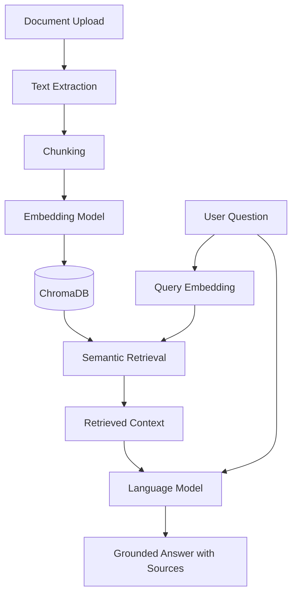

# KnowledgeDigger.io

**A private, document-grounded AI knowledge retrieval service powered by Retrieval-Augmented Generation (RAG).**

[](https://www.python.org/)
[](https://fastapi.tiangolo.com/)
[](https://docs.astral.sh/uv/)
[](https://www.docker.com/)
[](#-roadmap)

KnowledgeDigger.io is an AI-powered knowledge retrieval service designed to help users find relevant information from their own documents using natural-language queries.

The project aims to combine **Retrieval-Augmented Generation (RAG), document processing, semantic search, and open-source AI models** into a modular, containerized application. Rather than relying exclusively on an AI model's pretrained knowledge, the service will retrieve relevant content from a user's documents and use that context to generate grounded answers.

The goal is to build a private, extensible knowledge assistant that can grow from a reliable API foundation into a complete document intelligence platform.

> **Project status:** Under active development. The initial API foundation and containerization are being developed incrementally. RAG, document ingestion, OCR, and multi-user document isolation are planned capabilities, not yet completed features.

## Key Features

### Planned capabilities

- **Document-grounded question answering:** Ask questions about uploaded documents and receive answers based on retrieved content.
- **Retrieval-Augmented Generation:** Combine semantic retrieval with language models to improve the relevance and grounding of responses.
- **Multiple document formats:** Support PDF, DOCX, and TXT files.
- **OCR for scanned PDFs:** Extract text from scanned documents using an Optical Character Recognition pipeline.
- **Semantic search:** Find conceptually relevant passages rather than relying only on exact keyword matches.
- **Private document collections:** Design document storage and retrieval around user-specific access boundaries.
- **Open-source AI integration:** Use Hugging Face models and locally deployable components where suitable.
- **Vector database:** Use ChromaDB to store document embeddings and retrieve relevant chunks.
- **REST API:** Expose application functionality through a documented FastAPI interface.
- **Containerized deployment:** Use Docker and Docker Compose for reproducible development and deployment.
- **Configurable application:** Manage settings through environment variables and a validated configuration layer.

## Introduction

Retrieval-Augmented Generation (RAG) is an approach that connects a language model to an external knowledge source.

Instead of asking the model to answer a question from its pretrained knowledge alone, the application first searches relevant documents and supplies the retrieved passages as context.

The intended KnowledgeDigger.io workflow is:

1. **Upload:** A user submits a supported document.
2. **Extract:** The system extracts text from the document, using OCR when necessary.
3. **Chunk:** Extracted text is split into smaller, searchable sections.
4. **Embed:** An embedding model converts each section into a vector representation.
5. **Store:** The vectors, text chunks, and document metadata are stored for retrieval.
6. **Retrieve:** A user's question is embedded and matched against relevant document chunks.
7. **Generate:** A language model uses the question and retrieved context to produce an answer.
8. **Respond:** The API returns the answer and, where supported, source references.



*This diagram represents the planned RAG architecture.*

## Technology Stack

| Technology        | Purpose                                               |
| ----------------- | ----------------------------------------------------- |
| Python 3.12       | Primary backend language                              |
| FastAPI           | REST API framework                                    |
| Uvicorn           | ASGI server                                           |
| uv                | Python dependency and environment management          |
| Pydantic Settings | Validated configuration through environment variables |
| Hugging Face      | Model and embedding ecosystem                         |
| ChromaDB          | Planned vector storage and semantic retrieval         |
| Docker            | Application containerization                          |
| Docker Compose    | Planned multi-service orchestration                   |
| Pytest            | Automated testing                                     |
| Ruff              | Linting and code formatting                           |

Additional libraries for document parsing, OCR, embeddings, and generation will be selected and integrated as their milestones are implemented.

## Architecture and Design Goals

KnowledgeDigger.io is being developed with modularity and maintainability in mind.

The intended backend responsibilities include:

- **Configuration:** Centralized application settings and environment-specific configuration.
- **Controllers:** HTTP routes, request validation, and response handling.
- **Services:** Application logic independent of HTTP concerns.
- **Document processing:** File validation, extraction, chunking, and metadata preparation.
- **Retrieval:** Embedding generation, vector search, and context assembly.
- **Generation:** Language-model integration and answer construction.
- **Storage:** Document persistence and vector database integration.

The current application already uses an application factory-style wrapper to construct the FastAPI application and register routers and services. The architecture will evolve as the project grows.

## Project Structure

The structure below illustrates the intended organization. Some directories will be introduced in later milestones.

```text
Knowledge_Digger.io/
├── src/
│   ├── app.py
│   ├── config/
│   │   └── app_config.py
│   ├── controllers/
│   │   ├── health_controller.py
│   │   └── info_controller.py
│   ├── services/
│   │   ├── health_service.py
│   │   └── info_service.py
│   └── ...                 # Future application modules
├── tests/                  # Automated tests
├── data/                   # Local data; excluded from Git
├── .env.example            # Example configuration
├── .gitignore
├── .dockerignore
├── Dockerfile
├── docker-compose.yml      # Planned
├── main.py
├── pyproject.toml
├── uv.lock
└── README.md
```

The exact directory layout may change as implementation progresses.

## Getting Started

### Prerequisites

Install the following tools:

- [Python 3.12](https://www.python.org/downloads/)
- [uv](https://docs.astral.sh/uv/getting-started/installation/)
- [Git](https://git-scm.com/downloads)
- [Docker Desktop](https://www.docker.com/products/docker-desktop/) for containerized execution

The initial API foundation does not require downloading an AI model. Model and vector database requirements will be added in their respective milestones.

### 1. Clone the repository

```bash
git clone https://github.com/biswarup-naha/Knowledge_Digger.io
cd Knowledge_Digger.io
```

### 2. Install dependencies

```bash
uv sync
```

This installs the dependencies declared in `pyproject.toml` and resolves the environment using `uv.lock`.

### 3. Configure environment variables

Copy the example configuration:

**Windows PowerShell**

```powershell
Copy-Item .env.example .env
```

**Linux/macOS**

```bash
cp .env.example .env
```

Update `.env` as needed for your local environment. Never commit credentials, tokens, or private configuration values.

### 4. Run the API

For the current root-level `main.py` entry point:

```bash
uv run uvicorn main:app --reload --host 127.0.0.1 --port 8000
```

This command assumes `main.py` exposes the actual FastAPI application instance as `app` and its imports resolve from the project root.

### 5. Explore the API

If your configured API prefix is `/api/v1`, and the FastAPI documentation paths use that prefix, open:

- **Swagger UI:** `http://127.0.0.1:8000/api/v1/docs`
- **ReDoc:** `http://127.0.0.1:8000/api/v1/redoc`
- **OpenAPI schema:** `http://127.0.0.1:8000/api/v1/openapi.json`

Available endpoints depend on the controllers currently implemented.

## Docker

The project is being prepared for containerized execution.

Build the development image from the directory containing the `Dockerfile`:

```bash
docker build -t knowledge-digger-api:dev .
```

Run the container:

```bash
docker run -d \
  --name knowledge-digger-api \
  --env-file .env \
  -p 8000:8000 \
  knowledge-digger-api:dev
```

Inspect logs:

```bash
docker logs -f knowledge-digger-api
```

Stop the container:

```bash
docker rm -f knowledge-digger-api
```

**Note:** The Dockerfile's startup command must expose the FastAPI application and bind Uvicorn to `0.0.0.0` inside the container. Verify that dependencies are installed in the container's managed Python environment before relying on the deployment.

Docker Compose integration will be documented here after its configuration has been implemented and tested.

## Testing and Code Quality

Run the automated test suite:

```bash
uv run pytest -v
```

Check code quality:

```bash
uv run ruff check .
```

Format Python files:

```bash
uv run ruff format .
```

Verify the dependency lockfile:

```bash
uv lock --check
```

Tests and quality checks will expand alongside each milestone.

## Security and Privacy Guardrails

Privacy is a core design goal, particularly because users may upload private documents.

Planned safeguards include:

- User-level authorization for document access.
- Isolation of document retrieval between users.
- Upload size and file-type validation.
- Safe handling of uploaded files and extracted content.
- Secrets stored in environment variables rather than source control.
- Controlled access to stored document content and metadata.
- Tests covering cross-user document access and authorization boundaries.

These protections must be implemented and tested before the service is considered suitable for sensitive documents. A vector database or private deployment alone does not guarantee user-level isolation.

## Roadmap

The project is being built in incremental milestones.

- [X] **Milestone 1 — Initial API foundation:** Python project setup, FastAPI health endpoint, and development tooling.
- [X] **Milestone 2 — Configuration and logging foundation:** Validated settings, environment configuration, and structured logging.
- [X] **Milestone 3 — Containerization:** Docker image, reliable container execution, and Docker Compose integration.
- [ ] **Milestone 4 — Document ingestion:** File validation and support for PDF, DOCX, and TXT.
- [ ] **Milestone 5 — Text extraction and OCR:** Handle scanned PDFs and extract usable text.
- [ ] **Milestone 6 — Chunking and embeddings:** Prepare document chunks and vector representations.
- [ ] **Milestone 7 — Vector search with ChromaDB:** Store and retrieve relevant document passages.
- [ ] **Milestone 8 — RAG question answering:** Integrate a language model with retrieved context.
- [ ] **Milestone 9 — Multi-user privacy and authorization:** Enforce access boundaries and test isolation.
- [ ] **Milestone 10 — Evaluation and deployment:** Measure retrieval quality, improve reliability, and prepare deployment documentation.

> Roadmap checkboxes reflect the development plan and should be updated only when the corresponding work is implemented and verified.

## Contributing

Contributions, suggestions, bug reports, and architecture discussions are welcome.

A useful contribution workflow is:

1. Open an issue describing the proposed change or problem.
2. Create a feature branch.
3. Make focused changes with appropriate tests.
4. Run the test suite and Ruff checks.
5. Submit a pull request with a clear explanation.

Suggested branch naming:

```text
feature/document-ingestion
feature/vector-search
feature/rag-pipeline
fix/docker-startup
docs/readme-improvements
```

## Project Goals

KnowledgeDigger.io aims to demonstrate how to build a modular, testable, privacy-conscious RAG service from the ground up, while learning the underlying concepts of backend engineering, document processing, vector search, and AI integration.

The emphasis is on understanding and validating each component rather than assembling an opaque, ready-made system.

---

**KnowledgeDigger.io — Turn your documents into searchable knowledge.**
